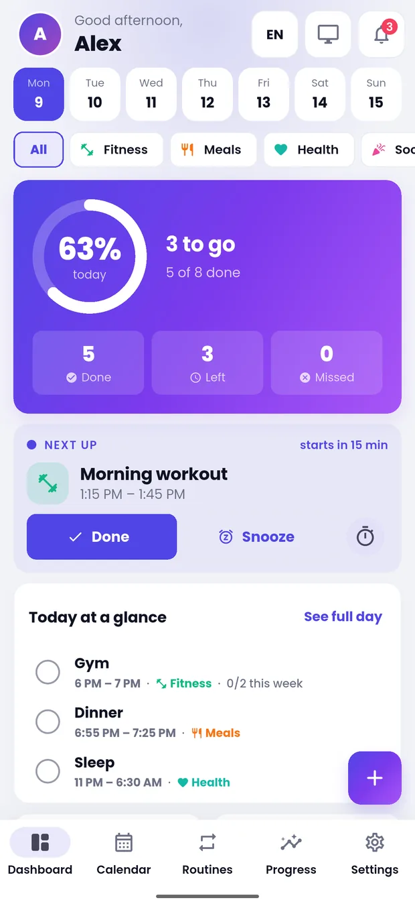
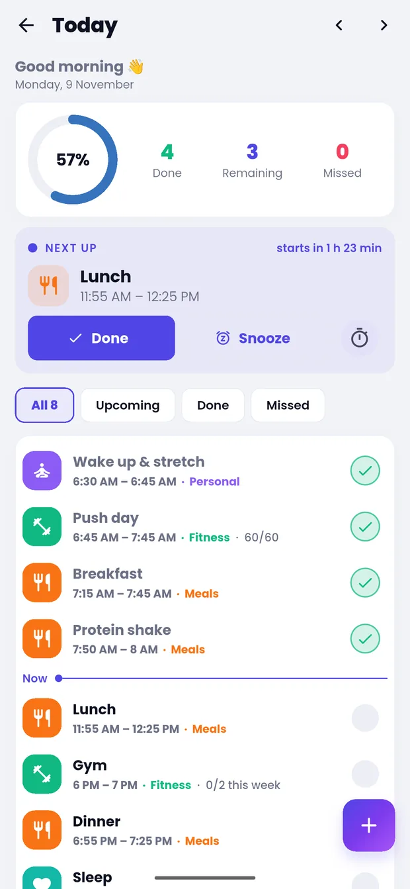
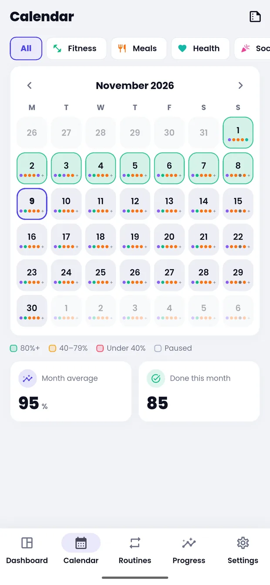
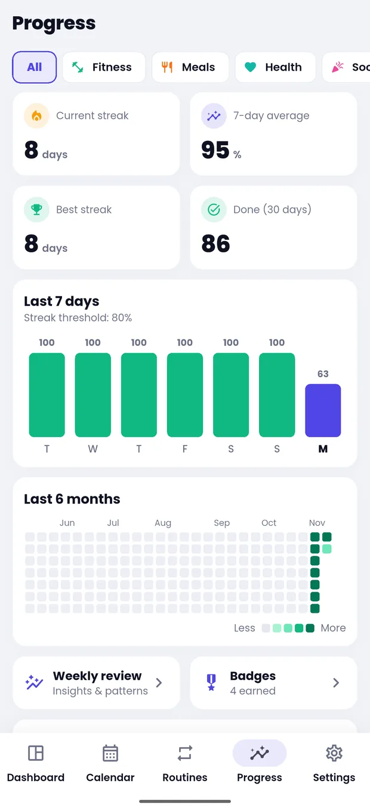

  

<h1 align="center">Tikki</h1>

<strong>Plan it. Tick it. Repeat it.</strong> A daily routine and habit tracker for Android.

  <a href="https://jotonsd.github.io/tikki-privacy/home.html"><strong>Visit the website</strong></a>
  &nbsp;·&nbsp;
  <a href="https://play.google.com/store/apps/details?id=com.jotonsutradhar.tikki"><strong>Download on Google Play</strong></a>
  &nbsp;·&nbsp;
  <a href="https://jotonsd.github.io/tikki-privacy/"><strong>Privacy policy</strong></a>

  
  
  
  

Tikki helps you plan a day that repeats, get reminded on time and see how consistent you really are. It needs no account, shows no ads and keeps your data on your phone.

## Features

- **Flexible routines:** repeat daily, on chosen days, or a few times a week or month
- **Events, goals and checklists:** time or count goals on any item
- **Reminders and alarms:** on-time reminders, or ring as an alarm with Stop, Snooze and Done
- **Streaks and progress:** streaks, charts, badges, challenges and monthly reports
- **Focus timer, quick add and templates:** type or say an item, or start from a ready-made routine
- **Pause days:** take a holiday or sick day without breaking your streak
- **Your way:** 13 languages, light and dark mode, and a home screen widget
- **Private:** optional PIN or fingerprint lock, with backup to a file

## Privacy

Tikki has no account and no servers. It contains no ads, analytics or tracking tools, and what you enter stays on your phone unless you choose to export or share it. Read the [privacy policy](https://jotonsd.github.io/tikki-privacy/).

## Requirements

Android 8.0 or later.

## About this repository

This repository hosts Tikki's website.

| File | Page |
| --- | --- |
| `home.html` | [Landing page](https://jotonsd.github.io/tikki-privacy/home.html) |
| `index.html` | [Privacy policy](https://jotonsd.github.io/tikki-privacy/) |

## Contact

Joton Sutradhar, [jotonsutradharjoy@gmail.com](mailto:jotonsutradharjoy@gmail.com)
